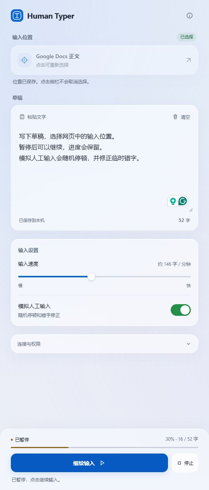

# Human Typer

在浏览器侧栏写草稿，逐字输入到你选择的网页位置。

Human Typer 是一个 Manifest V3 浏览器扩展，提供毛玻璃侧栏、实时进度、暂停继续，以及随机停顿和临时错字修正。

[下载 v1.5.0](https://github.com/AmaoQWQ/human-typer/releases/tag/v1.5.0) · [安装说明](INSTALL.md) · [MIT 许可证](LICENSE)



## 功能

- **选择网页输入位置**：保存输入框光标或选区。回侧栏编辑草稿后，开始输入时恢复目标位置。
- **实时进度**：每输入一个草稿字符，更新进度条、百分比和已输入字数。临时错字不计入进度。
- **暂停与继续**：开始后主按钮变为“暂停”；暂停后点击“继续输入”，从停下的位置接着打。暂停期间仍可停止。
- **模拟人工输入**：随机改变输入间隔和连续输入的节奏，随机短暂停顿或较长停顿。中文、英文和其他非空白文字输入时，都可能临时插入一个随机大小写英文字母，再退格删除并继续。
- **草稿本地保存**：草稿、速度和人工模式设置保存在浏览器本机。
- **极简侧栏**：系统字体、圆角、毛玻璃、键盘焦点与减少动态效果支持。草稿没有横线，界面没有额度标识。

关闭人工模式后，使用固定的基础输入间隔。扩展自身不设字数额度，网页输入框本身的长度和校验规则仍然生效。

## 安装

需要 Chrome 118+ 或支持 `sidePanel` API 的 Chromium 浏览器。主要实测环境为 Chrome；Edge 可通过“加载解压缩的扩展”安装，完整 Edge 流程尚未单独验收。

1. 在 [Release](https://github.com/AmaoQWQ/human-typer/releases/latest) 下载 **`human-typer-1.5.0.zip`**，这是安装包。
2. 解压到固定文件夹，确认里面直接包含 `manifest.json`。
3. Chrome 打开 `chrome://extensions`；Edge 打开 `edge://extensions`。
4. 开启“开发者模式”，点击“加载已解压的扩展程序”，选中该文件夹。
5. 点击工具栏里的 **Human Typer** 图标打开侧栏。

ZIP 是可加载的解压版扩展，不是商店安装包。`human-typer-1.5.0-source.zip` 包含开发源码和测试；安装时使用前一个包即可。Release 另提供 `SHA256SUMS.txt` 校验值。

更新时先停止输入，将新版本解压到原安装文件夹，重新加载扩展，再刷新目标网页并重开侧栏。详见 [INSTALL.md](INSTALL.md)。

## 使用

1. 点击侧栏“输入位置”按钮，再点击网页中的实际文字输入位置。
2. 确认侧栏显示正确的输入框或 Google 编辑器位置。
3. 回侧栏写入或粘贴草稿，调整输入速度和人工模式。
4. 点击“开始输入”，需要暂时停下时点击“暂停”，再点击“继续输入”接着打。
5. 点击“停止”结束任务。

点击侧栏时网页光标暂时隐藏是焦点切换的正常表现，已选择的位置仍会保留。

“继续输入”延续当前任务，不重打已输入内容。“停止”会结束任务，之后再次“开始输入”会输入整份草稿；续写前请调整草稿。刷新或关闭网页、重新加载扩展后，需要重新选择输入位置。

## Google 应用适配

| 应用 | 输入范围 | 操作提示 |
| --- | --- | --- |
| Docs | 正文、标题、普通评论输入框 | 正文中点击文字光标；标题、评论单独选择 |
| Sheets | 单个单元格、公式栏、标题 | 点击单元格，或先双击进入编辑；换行留在同一格，完成后自己按 Enter 确认 |
| Slides | 文本框、演讲者备注、标题 | 双击文本框，出现文字光标后再回侧栏；备注直接点击 |
| Gmail | 主题、正文、搜索框 | 打开草稿后选择主题或正文；单行输入框拒绝含换行的草稿 |
| Forms | 文字回答框、表单标题、说明、问题编辑区 | 点击具体文字输入区域 |
| Keep | 记事标题、正文、搜索框 | 打开记事再选择；标题只接受单行文字 |
| Drive | 搜索框、重命名对话框的名称输入框 | 先打开输入框；确认操作由自己完成 |

这是文字输入适配。Sheets 暂不支持一次跨格粘贴；Slides 不自动创建文本框。发送邮件、提交表单、发布、搜索确认和文件重命名确认需要自己操作。

### 输入位置与停止保护

- 普通文字输入框保存光标或选区；`contenteditable` 保存浏览器 Range。
- Google 画布编辑器保留自己的内部光标状态。Sheets 检查实际编辑区域、单元格和工作表；Slides 区分文本框和备注。
- 输入期间主动改变 Google 网页输入位置会停止任务；文档、工作表或幻灯片切换、目标移除或连接断开会提示重新选择。
- 暂停发生在错字修正途中时会保留现场；继续后先修正。停止时尝试清除临时错字；如果目标已改变，会停止并提示，避免在错误位置退格。

Google 网页结构可能随更新变化。遇到问题，请提供浏览器版本、扩展版本、应用名称、复现步骤及“连接与权限”的状态，草稿内容可省略。

## 权限与隐私

扩展没有服务器通信。草稿和设置保存到浏览器本机；输入到 Google 服务的文字按对应服务自己的规则保存到云端。

| 权限 | 用途 |
| --- | --- |
| `activeTab`、`scripting` | 点击扩展图标后，在当前网页记录输入目标并执行输入 |
| `sidePanel` | 显示浏览器侧栏 |
| `clipboardRead` | 点击粘贴按钮时读取剪贴板文字 |
| `storage` | 保存本机草稿、设置和当前任务状态 |
| `debugger` | Google 输入任务通过浏览器可信输入通道输入 |

`debugger` 是安装权限，具有访问标签页内容的能力。授权在扩展启用期间持续有效，断开连接不撤销权限。Google 输入任务进行或暂停时保留当前页的调试连接，完成、停止或出错后断开；普通网页不建立调试连接。Chrome 可能显示正在调试的提示。此权限不能声明为可选权限。[Chrome 官方说明](https://developer.chrome.com/docs/extensions/reference/api/permissions#step_2_declare_optional_permissions_in_the_manifest)

调试连接冲突时，请关闭目标页的开发者工具和其他调试连接后重试。浏览器内部页面、扩展页面和部分受保护网页无法输入。受管理设备也可能限制开发者模式或调试权限。

## 开发

运行时代码无需构建，不依赖第三方 JavaScript 包。开发检查使用 Node.js 22+，打包使用 Python 3.10+。

```sh
node tools/check.cjs
node tests/serve.cjs
```

打开 `http://127.0.0.1:8766/tests/focus.html`，点击“运行回归测试”。每次重新运行请刷新页面。侧栏界面预览位于 `/tests/panel.html`，使用模拟后台连接，不写入真实网页。

```sh
git add .
python tools/package.py
```

打包脚本读取已加入 Git 的源码，生成 `dist/` 下的安装 ZIP、源码 ZIP 和 SHA-256 校验文件。安装包使用固定文件列表，排除测试、网页截图、Git 数据和本地开发文件；源码包也排除这些本机私有目录。GitHub Actions 会执行自动检查并验证打包。

| 文件 | 作用 |
| --- | --- |
| `background.js` | 目标路由、Google 可信输入、任务状态与连接释放 |
| `content.js` | 输入位置识别、光标恢复、普通网页输入 |
| `google-apps.js` | Google 应用识别与提示 |
| `typing-behavior.js` | 共用随机节奏、临时错字与暂停调度 |
| `sidepanel.*` | 侧栏界面与控制 |
| `tools/` | 检查、打包与图标生成 |
| `tests/` | 协议测试与浏览器测试页面 |

## 检查范围

- **61 项自动回归**：后台 33 项、内容脚本 16 项、侧栏 7 项、随机行为 5 项。覆盖实时进度、暂停继续、停止、中文临时英文修正、输入位置失效、长度限制、并发开始、权限与连接释放；另检查清单、脚本语法和资源引用。
- **13 项本地浏览器输入测试**：文本框光标、选区、可编辑区域、暂停继续、暂停中错字修正、停止、2105 字输入和目标失效。
- **Chrome Google 输入核心实测**：Docs 正文；Sheets 中文、同格换行和失焦恢复；Slides 文本框和备注；Gmail 主题和正文；Forms 说明；Keep 标题和正文；Drive 搜索和重命名名称框。

Google 核心实测使用隔离脚本环境和测试消息接收器；画布按键使用浏览器操作工具发送的可信按键。Google 暂停调度和异常处理通过自动协议测试验证。Forms 回答页、Docs 评论和 Sheets 公式栏沿用普通文字输入框适配，本次未逐项线上验收。完整已安装扩展侧栏流程及 Edge 环境仍需安装后验收。

项目仓库不包含带账号信息、私人邮件或云端文件内容的测试截图。上方截图来自本地界面预览。

## 许可证

[MIT](LICENSE) · Copyright (c) 2026 AmaoQWQ
